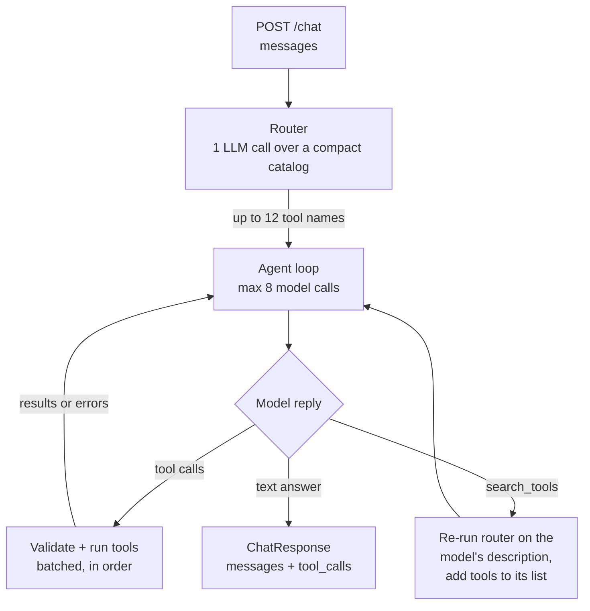

<!-- DRAFT. Jayden: rewrite in your own words before submitting. Lines marked TODO need a link or a number. -->

# Design: agentic tool orchestrator

Loom walkthrough: TODO (link, sharing set to anyone with the link)

## Overview

`POST /chat` takes the conversation so far, picks a few of the 191 mock tools, calls them and replies. A cheap router call shortlists the tools first. Then a hand-written loop lets the model call those tools, sends the results back, and stops when the model answers in text. Every real tool call goes into `tool_calls`.



The code is in `backend/solution.py` (glue) and `backend/helpers/`: `router.py`, `agent.py` (the loop), `prompts.py`, `llm.py` (model calls and the fallback model), `config.py` (models, limits, the mock's date) and `messages.py`.

## Tool routing

All 191 schemas come to about 72k tokens. Sending them on every call is slow and expensive, the model picks tools less accurately from a list that long, and on my test key a single call that size wouldn't even fit under the 60k tokens-per-minute limit. So the model sees a short list each turn. The options I considered:

| Option | Pros | Cons |
|---|---|---|
| A. Send all 191 every call | Simplest, can't miss a tool | ~72k tokens per call, slower, worse tool choice |
| B. Embedding similarity shortlist | No extra chat call | Can't add numpy; "summarize the email and post it to Slack" needs lookup tools the query never mentions |
| C. LLM router over a compact catalog | Understands multi-step tasks and lookups; ~4k tokens instead of ~72k; testable on its own | One extra LLM call per request |
| D. Pick services, then tools | Smaller prompts at each level | Two extra calls, more latency |
| E. Compact catalog in the main prompt, model loads tools itself | No separate router | Same number of calls as C in the common case; harder to test routing by itself |

I picked C. The router gets the whole conversation plus one line per tool (name and description, about 4k tokens) and returns up to 12 names. Its output is a strict JSON schema whose enum is the 191 real names, so it can't make up a tool, and the code checks the names against the registry anyway. The catalog sits in the instructions, so the start of the prompt is identical on every call and OpenAI's prompt cache served about 95% of the router's input tokens in my tests. Once warm, a router call takes about 1 to 2 s. If it fails, it returns an empty list and the request carries on.

I went with a separate router over E because I can test it by itself, it does one job, and the main model's context stays small. I haven't measured C against E. The cap of 12 is a judgment call: most tasks need 2 to 5 tools, 12 schemas are about 4.5k tokens, and OpenAI suggests staying under about 20 functions.

If the router misses a tool, the agent can call `search_tools` and describe what it needs ("send a message to a Slack channel"). That text goes back through the same router, and the tools it picks are added for the next round. My first idea was `load_tools(names)`, but the model can't know the exact names of tools it never saw, while a description is something it can write. A miss costs about two extra LLM calls. `search_tools` is my own meta-tool, not a registered tool, so it shows up in the trace but not in `tool_calls`. In live tests it recovered a missed Slack channel lookup twice.

Live testing showed two kinds of router miss. In a loud miss, a tool call fails (sending to a channel name instead of its ID), and the model then searches for the tool it's missing. A quiet miss is worse: a similar tool works but returns the wrong data, and the model accepts it. In one run the router picked `GMAIL_GET_PEOPLE`, which returns your own profile, instead of a contacts lookup. I fixed this in two places. The router now always includes the main search or list tool of each service the request touches. The agent is told that if a tool worked but its result doesn't have what it needs, it should try another tool or `search_tools` before saying it can't be done. After that change, "draft an email to Morgan Lee" and "post in the first channel" both passed with the minimum number of calls. It didn't fix the unread-email count: a weak router model (`gpt-5.4-nano`) ignored the new rule, and the agent read the profile's total message count as the unread count. A prompt rule is only a suggestion, so with more time I'd add each service's search tool in code.

## Orchestration loop

Each round calls the OpenAI Responses API with the system prompt as `instructions`, the conversation plus every tool call and result so far as `input`, and the routed schemas plus `search_tools` as `tools`. If the reply has no tool calls, its text is the answer and the loop stops. Otherwise each call is checked and run, its result or error goes back under its `call_id`, and the loop goes again. I wrote the loop by hand instead of using a framework so I can explain and debug every line.

The loop makes at most 8 model calls per request. On the last one the model gets `tool_choice="none"`, so it has to answer in text and say what it did and didn't finish. If it repeats a call with exactly the same arguments, the loop skips it and tells the model to use the earlier result.

The model can ask for several tool calls in one turn, and the prompt tells it to batch calls that don't depend on each other. That matters because latency comes from LLM rounds, not tools, which run in milliseconds. A batch runs in order on one thread, because the mocks update shared counters without locks and concurrent writes could collide. With real network tools I'd use a thread pool.

Strict mode keeps the arguments in schema shape, and pydantic in `ToolSpec.invoke` validates them again. A validation error or a tool exception (an unknown channel, a missing ID) goes back to the model as `{"error": ...}` so it can fix the call, and it's logged with `result: null`. Strict mode also makes the model send `null` for every optional argument it doesn't use; I drop those so the tool's own defaults apply and the log stays clean. If OpenAI can't be reached, the user gets a short apology plus whatever tool calls already ran, never a 500. Results longer than 20k characters are trimmed in what the model sees, and `tool_calls` keeps the full result.

The full message list goes to both the router and the agent on every request, so follow-ups like "post it in the first one" work.

For ambiguity, the prompt says to look something up when a tool can find it (a channel ID from its name), to ask one short question when only the user knows ("which project?"), and to change nothing until it's clear. Explicit writes like "delete X" go ahead without asking. The model must never say an action worked unless a tool confirmed it. Live testing added two rules. The model may only use IDs and email addresses that came from the user or a tool, because it had invented a channel ID (`C01ABCD2EFG`) and an address (`morgan.lee@example.com`). It also shouldn't call a tool for the date, since the mock's "now" (Apr 8 2026, 9:00 New York, read from the mock's `BASE_NOW`) is already in the prompt.

`OPENAI_MODEL` picks the model. `.env.example` sets `gpt-4.1-mini`, and if it's unset the default is `gpt-5.4-mini`. If the key can't use the chosen model (404 or 403), `llm.py` switches to `gpt-4.1-mini` and remembers that for the rest of the server's life, so a model access problem costs one fast failed request instead of failing every request.

For observability, the server console prints a trace line for every round (latency, tokens, tools requested), every tool call (arguments, latency, error, a preview of the result) and every `search_tools` lookup, plus one summary line per request.

## Testing

`tests/test_agent.py` has 9 unit tests that run the loop against a scripted fake OpenAI client. They cover a plain text reply, batched calls with an error, skipping a repeat, refusing a tool that wasn't offered, `search_tools` finding and not finding a tool, the forced text answer on the last round, an OpenAI failure and the model fallback.

`tests/test_scenarios.py` runs 17 live scenarios the way the grader does: reset, call `/chat`, then check the tools called, the `/state` snapshot and the reply. They cover single-tool lookups, Gmail to Slack, creating and commenting on Linear issues, a Slack thread lookup, a follow-up turn, an ambiguous meeting request (must ask and create nothing), a missing Drive file and Slack channel (nothing faked), a greeting and an out-of-scope request. It only runs with `RUN_LIVE=1`.

Every scenario has run live, and 16 of 17 passed on their latest run. Requests took about 2 to 9 s, with a median around 5 s, and most used the minimum number of tool calls. Main-model rounds used about 0.7k to 3.1k input tokens, compared with about 72k for sending every schema. My key was on OpenAI's free tier (50 requests per day per model), so I spread the runs across `gpt-4o-mini`, `gpt-5.4-mini` and `gpt-5.4-nano`. The models behaved differently: `gpt-4o-mini` invented an email address even with a contacts tool available, while `gpt-5.4-mini` looked it up or asked. TODO: a full run on `gpt-4.1-mini`, the model `.env.example` sets.

## What I'd do with another 8 hours

- Add each touched service's main search tool in code instead of relying on the router prompt, and add tests that catch the agent misreading a result (the unread-count failure).
- Measure router recall at caps of 8, 12 and 16, and compare C against E with real numbers.
- Run the scenario suite in CI, on the grader's model, on every change.
- Cache router picks for repeated or similar requests.
- Run independent tool calls in a thread pool once the tools are real network calls.
- Stream the reply so the user sees progress.
- Ask for confirmation before destructive actions in a real product. The grader expects an explicit delete to just happen, so I didn't here.

## How to run

From `candidate/`, with `OPENAI_API_KEY` in `.env`:

```
pnpm run dev
pnpm --filter backend test
pnpm run cli -- chat "What conversations do I have in Slack?"
```

Live scenarios: `RUN_LIVE=1`, optionally with `SCENARIOS=s01,s06` for a subset.
