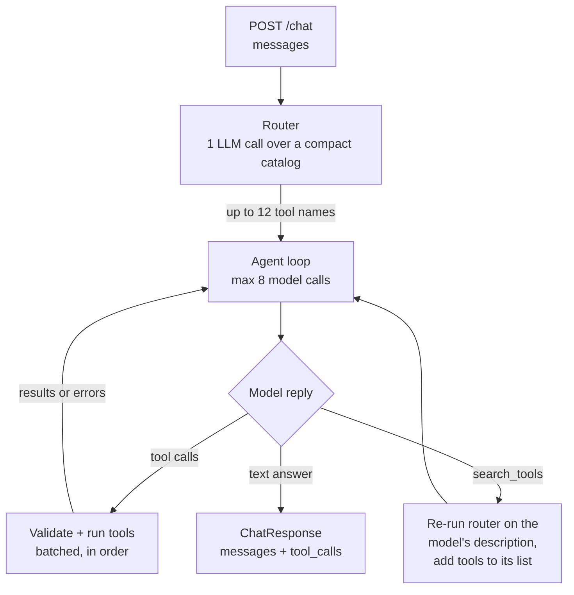

<!-- DRAFT. Jayden: rewrite in your own words before submitting. Lines marked TODO need a link or a number. -->

# Design: agentic tool orchestrator

Loom walkthrough: TODO (link, sharing set to anyone with the link)

`POST /chat` routes the conversation to a short list of tools with one cheap LLM call, then runs a hand-written loop where the model calls those tools until it can answer. Every real tool call goes into `tool_calls`.

## Tool routing

All 191 schemas come to about 44k tokens (measured through the API). Sending them every call is slow and costly, and tool choice gets worse with a list that long.

| Option | Pros | Cons |
|---|---|---|
| A. Send all 191 every call | Simplest, can't miss a tool | ~44k tokens per call, slower, worse tool choice |
| B. Embedding similarity shortlist | No extra chat call | Can't add numpy; "summarize the email and post it to Slack" needs lookup tools the query never mentions |
| C. LLM router over a compact catalog | Understands multi-step tasks and lookups; ~4k tokens; testable on its own | One extra LLM call per request |
| D. Pick services, then tools | Smaller prompts at each level | Two extra calls, more latency |
| E. Compact catalog in the main prompt, model loads tools itself | No separate router | Same number of calls as C; harder to test routing by itself |

I picked C. The router sees the conversation plus one line per tool and returns up to 12 names, about 10x fewer tokens than every schema. Its output enum is the 191 real names, so it can't make up a tool. The catalog sits in the instructions, so the prompt cache served about 95% of its input. I chose it over E because routing can be tested by itself. The cap of 12 is a judgment call: most tasks need 2 to 5 tools, and 12 schemas are only about 2.7k tokens.

If the router misses a tool, the agent calls `search_tools` with a description ("send a message to a Slack channel"), which goes back through the router and adds tools for the next round. A `load_tools(names)` version wouldn't work, since the model can't know names it never saw. It recovered a missed Slack lookup twice in live tests, and it's traced but never logged in `tool_calls`.

Live tests also showed quiet misses: a similar tool returns the wrong data (your own profile instead of your contacts) and the model accepts it. The router now always includes each touched service's main search tool, and the agent tries another tool when a result lacks what it needs. That fixed two scenarios, but a weak router model still ignored the rule once.

## Orchestration loop

- Each round sends the prompt, the conversation with all tool results so far, and the routed schemas to the Responses API. A reply with no tool calls is the answer.
- At most 8 model calls. The last uses `tool_choice="none"`, forcing an answer that says what wasn't finished. Exact repeat calls are skipped.
- The prompt asks for independent calls in one turn, since latency comes from LLM rounds. A batch runs in order because the mocks update shared counters without locks. Real network tools would get a thread pool.
- Bad arguments and tool exceptions go back to the model as `{"error": ...}` so it can fix the call, and are logged with `result: null`. If OpenAI is down, the user gets an apology plus the calls already made, never a 500. If the key can't use the chosen model, it falls back to `gpt-4.1-mini` once.
- The model looks things up when a tool can answer and asks one short question when only the user knows, changing nothing until it's clear. It may only use IDs and addresses from the user or a tool (it invented both in testing), and never claims a write worked unless a tool confirmed it.
- The full conversation goes to the router and agent every request, and the mock's date is in the prompt, so follow-ups and "next week" work. The server console traces every round and tool call.

## Testing and trade-offs

There are 9 unit tests against a fake LLM and 17 live scenarios run like the grader (reset, `/chat`, check tools, `/state` and the reply). 16 of 17 pass, at a median of about 5 s per request, on `gpt-4o-mini` and `gpt-5.4-mini`/`nano` because of free-tier limits. TODO: full run on `gpt-4.1-mini`, which `.env.example` sets.

The main trade-off: the router adds a call and 1 to 2 s to every request, even greetings, for much smaller prompts and testable routing.

## With another 8 hours

- Enforce each touched service's search tool in code, and test that the agent reads results correctly (the failing scenario reads a total count as unread).
- Measure router recall at caps of 8, 12 and 16, and compare C against E.
- Run the scenario suite in CI on the grader's model.
- Cache router picks for repeated requests.
- Ask for confirmation before destructive actions in a real product.
