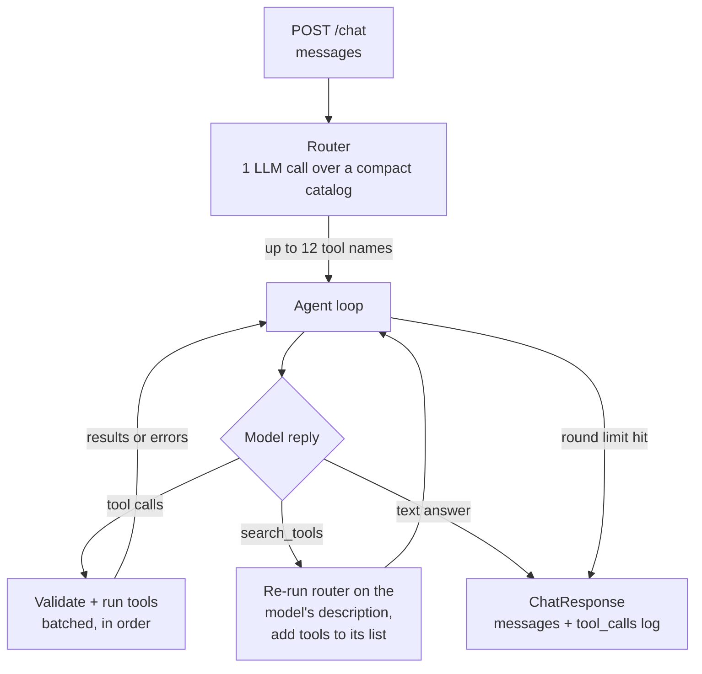

<!-- DRAFT. Jayden: rewrite in your own words before submitting. Lines marked TODO need real numbers or a decision. -->

# Design: agentic tool orchestrator

Loom walkthrough: TODO (link, sharing set to anyone with the link)

## Overview

`POST /chat` takes the conversation so far, works out which of the 191 mock tools it needs, calls them, and replies. It does this in two steps. A cheap router call picks a short list of tools. Then a hand-written loop lets the model call those tools, feeds the results back, and stops when the model has an answer. Every tool call is logged in `tool_calls`.

## Architecture



Files (all in `backend/`):

| File | What it does |
|---|---|
| `solution.py` | Glue: router, then loop, then build the response |
| `helpers/config.py` | Loads `.env`, model names, limits, the mock's current date |
| `helpers/prompts.py` | Router prompt and agent system prompt |
| `helpers/router.py` | Compact catalog, the shortlist call, name checks |
| `helpers/agent.py` | The loop |

## How a request is handled

1. `solution.py` gets the message list.
2. The router sends the conversation plus a compact catalog (each tool's name and a one-line description) to the model and gets back up to 12 tool names. Any name that isn't in the registry is dropped.
3. The loop calls the model with the system prompt, the conversation, and full schemas for only the shortlisted tools (from `get_openai_tools(names)`), plus a `search_tools` meta-tool.
4. If the model asks for tool calls, each one is validated and run. Independent calls come back together in one turn and run back to back. Each result or error goes back to the model and into the `tool_calls` log.
5. Repeat until the model answers in text or the round limit is hit.
6. Return the conversation with the assistant's reply appended, plus the full `tool_calls` log.

## Tool routing

All 191 schemas come to about 72k tokens. Sending them on every call is slow and expensive, and the model picks tools less accurately with a list that long. So the model needs to see a smaller set each turn. Options I considered:

| Option | Pros | Cons |
|---|---|---|
| A. Send all 191 every call | Simplest, can't miss a tool | ~72k tokens per call, slower, worse tool choice |
| B. Embedding similarity shortlist | No extra chat call | Needs embeddings for the catalog and the query; can't add numpy; a query like "summarize the email and post it to Slack" is about two services and needs lookup tools it never mentions |
| C. LLM router over a compact catalog | Understands multi-step tasks and lookup steps; ~4-5k tokens instead of ~72k; testable on its own | One extra LLM call per request |
| D. Two-level: pick services, then tools | Smaller prompts at each level | Two extra calls, more latency |
| E. Compact catalog in the main prompt, model loads tools itself | No separate router | Same number of LLM calls as C in the common case; harder to test routing on its own |

I picked **C**, with a `search_tools` fallback (an idea taken from E) as a safety net. The router reads the whole conversation, so follow-ups like "do the same for the other channel" still route correctly. It's told to think through the full task, including lookups (to post to a channel by name you first need its ID), and to include both tools when unsure, because a missing tool costs more than an extra one.

The router's output uses a strict JSON schema whose `enum` is the list of the 191 real tool names, so it can't make up a tool name. The code still filters against the registry anyway. The catalog goes in the instructions, so the start of the prompt is identical on every call and OpenAI's automatic prompt caching can reuse it. If the router call fails, it returns an empty list and the request carries on instead of erroring.

If the router misses something, the main model can call `search_tools` and describe what it needs in plain words ("send a message to a Slack channel"). That text goes back through the same router, and the tools it picks are added to the model's list for the next round. My first idea was a `load_tools(names)` meta-tool, but the model only sees the shortlisted tools, so it can't know the exact names of the ones it's missing. A description is something it can actually write. A miss costs about two extra LLM calls (the re-route plus one more round), but the request still works. `search_tools` is my own meta-tool, not a registered tool, so it shows up in the trace and not in `tool_calls`, and it doesn't count against the minimum number of calls.

A cheaper fallback would be keyword search over the catalog instead of a second router call: faster and free, but probably less accurate on descriptions that don't share words with the tool's description.

I went with a separate router over E mainly because I can test it by itself (did the router pick the tools each scenario needed?), it does one focused job, and it keeps the main model's context small. I haven't measured C against E yet. TODO: compare them if there's time and put the numbers here.

## Orchestration loop

- **Hand-written loop, no framework.** It's short, and I can explain and debug every line. It uses OpenAI's Responses API with strict tool schemas from the scaffolding.
- **Batched calls.** The model can ask for several tools in one turn, and the prompt tells it to batch calls that don't depend on each other. Most of the latency comes from LLM round trips, so fewer rounds means faster answers. The calls in a batch run one after another, not in threads: the mocks update shared counters without locks (e.g. Slack message IDs), so concurrent writes could collide, and each tool only takes milliseconds anyway. With real network-backed tools I'd run them in a thread pool.
- **No up-front plan.** The router only picks tools. It doesn't decide the order. A plan-then-execute design can't react to what a tool returns (for example, an email that doesn't exist), so the loop decides each step after seeing the last result.
- **Limits.** At most 8 model calls per request (`MAX_ROUNDS`). If the model repeats a call with the exact same arguments in one turn, the loop skips it and tells the model to use the earlier result. On the last round the model gets `tool_choice="none"`, so it has to answer in text and say what it did and didn't finish.
- **Conversation state.** The full message list goes to both the router and the agent every request, so earlier turns carry over.
- **Current date.** The mock data is frozen at Wed Apr 8 2026, 9:00 New York time. That date goes in the system prompt (read from the mock's `BASE_NOW`), so "next week" is resolved correctly without spending a tool call.
- **Big results.** Tool results are trimmed to 20k characters in what the model sees. The `tool_calls` log always keeps the full result.

## Ambiguity and errors

- **Asking vs. looking up.** If the request is missing something a tool can find (a channel ID from its name), the model looks it up. If it's missing something only the user knows ("the project" when no project is named), it asks one short question and doesn't change any data.
- **Several matches.** If a lookup returns more than one equally good match for something it's about to change, it asks which one.
- **Explicit writes go ahead.** "Delete X" is a clear instruction, so it doesn't ask for confirmation first.
- **Bad arguments.** Strict mode keeps the arguments in schema shape, and pydantic in `ToolSpec.invoke` validates them again. A validation error goes back to the model as the tool result, so it can fix the call and retry.
- **Tool errors and missing things.** Errors are logged with `result: null` and the error message. The prompt says to report a missing file, email or channel plainly and never claim success unless a tool confirmed it.
- **No crashes.** An unknown tool name, a tool exception or an OpenAI error is caught and turned into an error result or a fallback reply, never a 500.

## Trade-offs

- **Latency vs. accuracy.** The router adds one LLM call to every request, including greetings. I accepted that for better tool choice and a much smaller main prompt. In a first live run on the README examples with `gpt-4.1-mini`, the router took 1.4 to 4.7 s per call (the first call is slowest). TODO: re-measure over the full scenario set.
- **Cost.** A router call costs about 5k tokens, compared with about 72k for sending every schema on each round. Multi-round tasks save more.
- **Observability.** Every call is in `tool_calls` with its arguments, result and error. TODO: describe the trace/logging (latency per step, router picks).
- **Maintainability.** Prompts, limits and model names live in `config.py` and `prompts.py`. Adding a tool to the registry needs no routing code changes, because the catalog is built from the registry.

## Testing

- Unit tests (`tests/test_agent.py`) run the loop against a scripted fake LLM: round limit, repeated call stop, error passing, batched calls, `search_tools`, OpenAI failure.
- Scenario tests (`tests/test_scenarios.py`) work like the grader: reset, chat, check which tools were called and the end state. They cover single tool, cross-service, ambiguous, missing file, no tool needed and a follow-up turn. TODO
- Results: TODO (pass rate, p50 latency, extra calls)

## Limitations and what I'd do with 8 more hours

- Measure router C against option E and pick based on data.
- Cache router picks for repeated or similar queries.
- Stream the reply so the user sees progress.
- Run the scenario suite in CI on every change.
- Per-tool permissions, with a confirmation step for destructive actions in a real product (the grader expects explicit deletes to just happen).
- TODO: anything the test results point to.

## How to run

From `candidate/`, with `OPENAI_API_KEY` in `.env` (optional: `OPENAI_MODEL`, default `gpt-4.1-mini`):

```
pnpm run dev
pnpm --filter backend test
pnpm run cli -- chat "What conversations do I have in Slack?"
```
